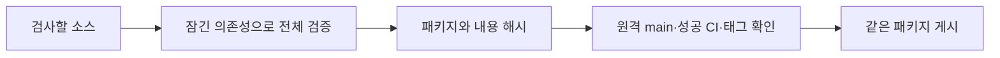

# 검증과 릴리스

로컬과 CI는 `python3 scripts/verify.py`로 같은 검사를 실행한다. 릴리스는 원격
`main`의 성공한 CI가 만든 패키지를 사용하며, 게시할 때 다시 빌드하지 않는다.



## 로컬 검증

개발 검증용 Python·uv 버전은 `.python-version`과 `.uv-version`, 테스트·빌드
의존성은 `uv.lock`으로 고정한다. 런타임 패키지의 지원 범위와 검증용 버전은 구분한다.

```bash
python3 scripts/verify.py
python3 scripts/verify.py --workers 2
```

기본은 직렬 실행이며, 환경에서 이점이 있을 때 worker 수를 명시해 병렬 실행한다.
포맷 검사 → 린트 → 전체 테스트 → sdist·wheel 빌드 → wheel 소스 대조와
패키지 smoke 검증 순서이며, 실패하면 다음 단계로 진행하지 않는다. 소스 배포본은
명시한 경로만 포함한다. 검사한 파일만 복제한 임시 소스에서 빌드하고, 기록한 소스
목록에 없는 파일이 배포본에 섞이면 거부한다. 검증 중 소스가
바뀌면 성공 기록을 만들지 않는다. 검증은 포맷이나 버전을 자동 수정하지 않는다.

결과는 새 `output/verification-*`에 저장된다. `result.json`에는 단계별 명령·시간·종료
코드·로그 위치가, `tests.xml`에는 테스트 결과가 남는다. 성공한 `dist/`에는 배포본
두 개와 `provenance.json`, `SHA256SUMS`가 생긴다. 검사한 커밋·소스·잠금 파일·도구
버전과 배포본 해시를 기록한다. 진단 시간과 로그는 재현할 배포본 내용과 구분한다.

현재 작업 트리에서도 검사할 수 있다. 미커밋 변경이 있으면 `clean=false`이며 그
로컬 산출물은 게시에 사용하지 않는다. 특정 테스트는 `uv run --locked pytest tests/test_xxx.py`로 디버깅할 수 있지만 이 부분 실행은 전체 검증을 대신하지 않는다.

## 버전 준비와 리뷰

현재 버전이 0.8.1이면 기본 패치 목표는 0.8.2다. 정확한 목표를 한 번 정해 전달한다.
실패 뒤 재실행해도 버전을 다시 증가시키지 않는다. 마이너·메이저 변경은 사용자가
명시한 경우에만 선택한다.

```bash
python3 scripts/release.py prepare 0.8.2
python3 scripts/verify.py
```

준비 명령은 임시 디렉토리에서 잠금 파일을 먼저 갱신하고 패키지·플러그인·마켓플레이스
버전 일치를 확인한 뒤 네 파일을 반영한다. 잠금 실패나 준비 중 사용자 수정이 있으면
기존 파일을 덮지 않는다. 같은 목표 버전의 재실행은 변경하지 않는다.

이후 저장소의 브랜치·커밋·PR 리뷰 규칙을 따른다. 보호 규칙과 Git 훅을 유지하고,
승인된 PR이 main에 합쳐진 뒤 그 커밋의 CI가 성공할 때까지 기다린다. 버전 준비
명령은 커밋·푸시·머지·게시를 수행하지 않는다.

## 검증된 커밋 게시

원격 main의 정확한 40자리 커밋 SHA와 준비한 릴리스 노트 파일을 사용한다.

```bash
python3 scripts/release.py publish --commit <40자리-SHA> --notes-file <노트.md> --dry-run
python3 scripts/release.py publish --commit <40자리-SHA> --notes-file <노트.md>
```

`--dry-run`은 CI 산출물과 기존 태그·릴리스를 읽어 게시 계획만 반환한다. 게시 명령은
원격 main, 정확한 커밋의 최신 성공 CI, 완료 기록과 해시를 확인한다. PR이나 다른
저장소의 실행, 실패 후 남은 예전 성공 실행은 게시 근거로 사용하지 않는다.

태그는 검증한 커밋에 만든다. 기존 태그가 다른 커밋을 가리키거나 같은 이름의 산출물
내용이 다르면 중단한다. 같은 결과는 재사용하며, 일치하는 미완료 릴리스에는 빠진
산출물만 추가한다. 게시한 파일을 덮거나 태그를 옮기지 않는다. 마지막으로 태그
커밋·게시 상태·산출물 목록과 URL을 확인한다.

실제 게시에는 그 작업에 대한 사용자 권한과 GitHub 접근 권한이 필요하다. 개발 중
자동 테스트는 GitHub 대역으로 잘못된 커밋·실패한 CI·변조·재시도 경로를 검사하며,
실제 원격 게시 성공을 의미하지 않는다.
